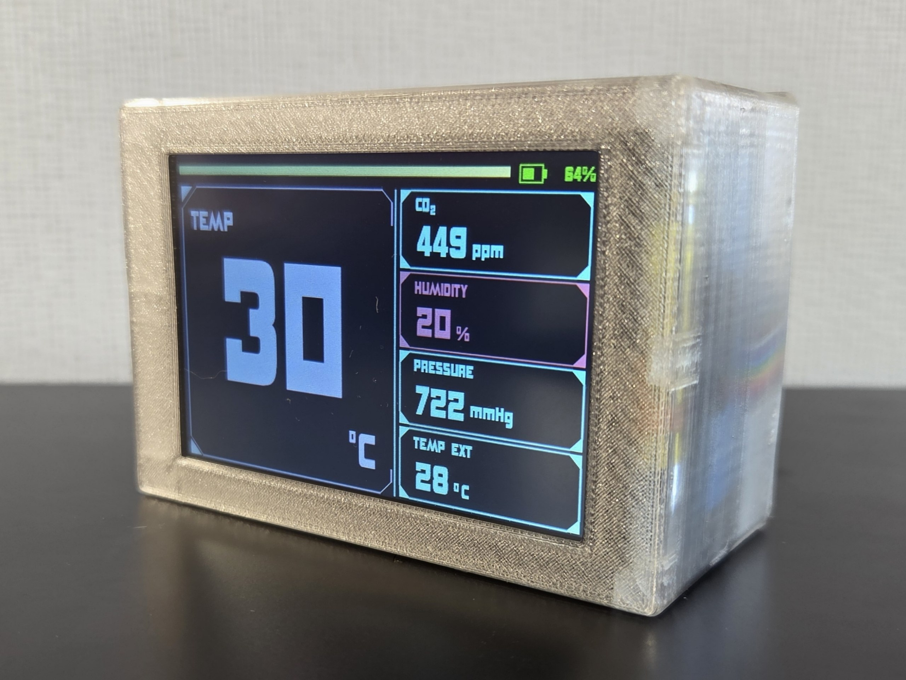

# ESP32-C6 Meteo Touch Station

Touch-controlled indoor climate station firmware for an ESP32-C6 and a 3.5-inch ILI9486 display. The 480x320 dashboard shows indoor and external temperature, humidity, CO2, pressure, and battery state without physical buttons.

## Features

- Landscape 480x320 dashboard with XPT2046 resistive touch.
- Touch-selectable focus metric with all five measurements kept visible.
- Color-coded humidity, pressure, and CO2 warnings.
- Cooperative sensor polling that keeps touch input responsive.
- Last-valid-value retention when a sensor returns an invalid sample.
- Built-in display test, touch calibration, and photo/video demo modes.
- Project-local ILI9486 display driver and flash-resident antialiased fonts.

See [DOCS.md](DOCS.md) for firmware architecture, polling logic, calibration details, thresholds, and troubleshooting.

## Hardware

| Component | Supported hardware |
|---|---|
| Controller | ESP32-C6 development board with ESP32-C6-DevKitC-1-style GPIO availability |
| Display | LCDWiki 3.5-inch RPi Display, ILI9486, 320x480 native resolution |
| Touch | XPT2046 resistive controller on the display's shared SPI bus |
| Humidity and indoor temperature | DHT11 |
| Pressure and indoor temperature | BMP280 |
| CO2 | MH-Z19B, 5000 ppm variant |
| External temperature | DS18B20 (optional) |
| Battery | Single-cell Li-ion or LiPo through a resistor divider |

The display is used in 480x320 landscape orientation. Its backlight is expected to be wired permanently on; the firmware does not provide brightness control.

## Default Wiring

Display and touch signals use the right-side breadboard pins. Sensors and battery measurement use the left-side pins.

| Function | ESP32-C6 GPIO |
|---|---:|
| TFT SCK / touch SCK | `8` |
| TFT MOSI / touch MOSI | `19` |
| Touch TP_SO / SPI MISO | `15` |
| TFT LCD_CS | `14` |
| TFT DC / RS | `20` |
| TFT RST | `18` |
| Touch TP_CS | `9` |
| BMP280 SDA | `2` |
| BMP280 SCL | `1` |
| DHT11 data | `3` |
| ESP32-C6 RX from MH-Z19 TX | `4` |
| ESP32-C6 TX to MH-Z19 RX | `5` |
| DS18B20 data | `6` |
| Battery ADC | `0` |

The MH-Z19 UART lines are crossed: sensor `TX` connects to GPIO `4` and sensor `RX` connects to GPIO `5`.

### DS18B20 electrical requirements

Connect DS18B20 `GND` to `GND`, `VDD` to `3V3`, and `DQ` to GPIO `6`. Add a `4.7k` pull-up resistor between `DQ` and `3V3`.

Do not pull the data line up to `5V`; ESP32-C6 GPIOs use 3.3 V logic. If the sensor must be powered from `5V`, use appropriate level shifting for its data line. The firmware expects one externally powered DS18B20 and does not support parasite-power mode.

### Battery measurement

The default circuit uses a `100k` top resistor from battery positive to GPIO `0` and a `100k` bottom resistor from GPIO `0` to ground. A 4.2 V battery therefore presents about 2.1 V to the ADC. The divider output must never exceed the ESP32-C6 ADC input range.

## Software Requirements

- Arduino IDE with an ESP32 core version that supports ESP32-C6.
- Adafruit GFX Library.
- Adafruit BMP280 Library.
- Adafruit Unified Sensor.
- XPT2046_Touchscreen.

DHT11 and DS18B20 communication is implemented by this project; external DHT, OneWire, and DallasTemperature libraries are not required.

## Configuration

The operating modes are compile-time options in [`meteo_config.h`](meteo_config.h):

| Setting | Default | Purpose |
|---|---:|---|
| `METEO_DISPLAY_ONLY` | `0` | Draw a display test pattern without touch or sensors. |
| `METEO_TOUCH_CALIBRATION` | `0` | Run the nine-point touch calibration utility. |
| `METEO_DEMO_MODE` | `0` | Show stable dashboard values for photos or video while retaining live DS18B20 support. |

Display-only mode takes precedence over touch calibration, and both take precedence over demo mode. With all three settings at `0`, the station uses live sensors normally.

Demo values and the external-temperature switching threshold are also configurable in `meteo_config.h`. Display pins and touch calibration constants are near the top of [`meteo_touch.ino`](meteo_touch.ino); sensor pins and electrical constants are in [`sensors.h`](sensors.h).

## Build and Upload

1. Clone or download the repository.
2. Install the libraries listed above in Arduino IDE.
3. Open `meteo_touch.ino`.
4. Select an ESP32-C6 board, such as ESP32-C6-DevKitC-1.
5. Confirm the wiring and configuration values.
6. Build and upload the sketch.
7. Open Serial Monitor at `115200` baud to see initialization and sensor diagnostics.

## Touch Calibration

Each physical touch panel should be calibrated before normal use:

1. Set `METEO_TOUCH_CALIBRATION` to `1` in `meteo_config.h`.
2. Upload the sketch and open Serial Monitor at `115200` baud.
3. Tap, briefly hold, and release each of the nine displayed targets.
4. Copy the seven generated `TOUCH_*` definitions into `meteo_touch.ino`.
5. Set `METEO_TOUCH_CALIBRATION` back to `0` and upload again.

See [Touch calibration](DOCS.md#touch-calibration) for the complete procedure and diagnostics.

## License

This project is licensed under the [GNU General Public License version 3](https://www.gnu.org/licenses/gpl-3.0.en.html). Distributed modified versions must provide their corresponding source under the same license terms.
